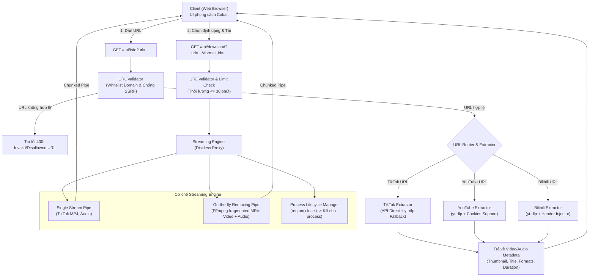

# Kế hoạch phát triển: Website tải video TikTok, YouTube, Bilibili (Lấy cảm hứng từ Cobalt)

## 1. Mô tả mục tiêu (Goal Description)
Xây dựng một ứng dụng web hoàn chỉnh phục vụ việc tải video và âm thanh từ 3 nền tảng phổ biến: **TikTok**, **YouTube**, và **Bilibili**. Ứng dụng áp dụng trực tiếp các bài học kinh nghiệm và kiến trúc ưu việt từ [Cobalt](https://cobalt.tools/):
* **Trải nghiệm tối giản & sạch sẽ (Clean & Ad-Free):** Không quảng cáo, không pop-up, giao diện trung tâm dạng Omnibox tự động nhận diện link.
* **Kiến trúc Diskless Streaming Proxy:** Không lưu trữ file tạm trên ổ cứng server, dữ liệu được truyền trực tiếp (pipe/stream) từ nguồn về client giúp tối ưu tài nguyên, không nghẽn ổ đĩa.
* **Xử lý chuyên sâu cho từng nền tảng:**
  * **TikTok:** Tải video **không watermark (no watermark)** chất lượng cao nhất, tải riêng âm thanh gốc (MP3), và hỗ trợ tải **album ảnh (slide photo)**. Sử dụng API chuyên dụng kết hợp fallback yt-dlp.
  * **YouTube:** Trích xuất các độ phân giải (360p, 720p, 1080p, 1440p, 4K), trích xuất audio riêng (MP3/M4A). Remuxing trực tiếp on-the-fly luồng DASH (Video + Audio) bằng FFmpeg mà không lưu file đĩa. Hỗ trợ cookies tùy chọn để tránh chặn bot datacenter.
  * **Bilibili:** Hỗ trợ link Bilibili quốc tế (`bilibili.tv`) và Bilibili nội địa (`bilibili.com`), bóc tách video và audio tương ứng, tự động đính kèm header `Referer` chống lỗi 403 Forbidden.
* **Phạm vi tính năng phiên bản này:**
  * Tập trung chất lượng cao nhất cho video đơn lẻ của 3 nền tảng cốt lõi và album ảnh TikTok.
  * Tạm thời chưa hỗ trợ tải toàn bộ playlist/channel YouTube hay Bilibili (để bảo vệ băng thông và tài nguyên server).

---

## 2. Kiến trúc hệ thống (System Architecture)



---

## 3. Lựa chọn Công nghệ (Tech Stack)

* **Backend Runtime:** **Node.js (v22)** với **Express.js (ES Module)**.
* **Core Media Tools:**
  * `yt-dlp` (Binary tự động tải về thư mục `bin/`): Bóc tách media stream mạnh mẽ nhất, xử lý định dạng DASH YouTube và Bilibili, hỗ trợ cập nhật tự động.
  * `ffmpeg-static`: Cung cấp binary FFmpeg độc lập không cần cài đặt qua sudo/apt, dùng cho việc remux stream DASH on-the-fly (`-movflags frag_keyframe+empty_moov`).
  * `archiver` (Tùy chọn): Đóng gói ZIP on-the-fly khi người dùng tải toàn bộ album ảnh TikTok.
  * `axios` / `node-fetch`: Thực hiện request nhanh tới API chuyên dụng (TikTok API không watermark).
* **Frontend:**
  * Single Page Web App (HTML5, Tailwind CSS, JavaScript hiện đại thuần).
  * Phong cách Cobalt: Giao diện Omnibox tối giản, hỗ trợ Dark/Light mode, nút dán nhanh từ clipboard, hiển thị preview thông tin video trước khi tải, chọn định dạng trực quan.
* **Triển khai & Vận hành:**
  * Đóng gói trọn gói, dễ chạy (`npm install && npm start`).
  * Có sẵn cấu hình `Dockerfile` để triển khai lên VPS, Docker hoặc các nền tảng container.

---

## 4. Chi tiết các thành phần (Proposed Components)

### 4.1. Cấu trúc thư mục dự án
```text
tool-download-video/
├── bin/                       # Nơi lưu trữ/tự tải yt-dlp binary
├── src/
│   ├── config.js              # Cấu hình PORT, MAX_DURATION, TIMEOUT, COOKIES_PATH
│   ├── utils/
│   │   ├── validator.js       # Xác thực URL whitelist, chống SSRF
│   │   └── formatHelper.js    # Chuẩn hóa nhãn format, dung lượng ước tính
│   ├── extractors/
│   │   ├── tiktok.js          # Trích xuất TikTok (no-watermark, audio, photo slides)
│   │   ├── youtube.js         # Trích xuất YouTube formats (360p -> 4K, audio)
│   │   ├── bilibili.js        # Trích xuất Bilibili formats (kèm referer headers)
│   │   └── index.js           # Bộ điều phối phân loại URL
│   ├── services/
│   │   ├── ytdlpService.js    # Wrapper tương tác với yt-dlp binary
│   │   └── streamService.js   # Diskless proxy pipe, on-the-fly FFmpeg muxing, kill process on disconnect
│   ├── routes/
│   │   ├── info.js            # Route /api/info
│   │   └── download.js        # Route /api/download
│   ├── server.js              # Express server setup & error handling
│   └── setup-binaries.js      # Script tự động tải yt-dlp binary phù hợp OS
├── public/
│   ├── index.html             # Giao diện chính (Cobalt style UI)
│   ├── app.js                 # Xử lý tương tác UI, gọi API, clipboard, UX stream
│   └── style.css              # Tùy biến giao diện hiện đại
├── package.json
└── README.md
```

### 4.2. Thiết kế chi tiết các dịch vụ lõi (Core Services)

#### 1. Bảo mật & Chống SSRF (`src/utils/validator.js`)
* Whitelist domain nghiêm ngặt:
  * TikTok: `tiktok.com`, `vm.tiktok.com`, `vt.tiktok.com`, `douyin.com`
  * YouTube: `youtube.com`, `youtu.be`, `m.youtube.com`, `www.youtube.com`
  * Bilibili: `bilibili.com`, `bilibili.tv`, `b23.tv`
* Chặn mọi IP private / localhost / loopback (`127.0.0.1`, `localhost`, `10.0.0.0/8`, `172.16.0.0/12`, `192.168.0.0/16`, `169.254.169.254`).
* Giới hạn thời lượng: Từ chối tải nếu video dài hơn `MAX_DURATION` (mặc định 1800 giây / 30 phút) để bảo vệ tài nguyên CPU.

#### 2. Xử lý Stream On-the-fly & Quản lý tiến trình (`src/services/streamService.js`)
* **Trường hợp 1 (Direct Stream):** Single stream (TikTok MP4, Audio MP3/M4A) -> Pipe trực tiếp từ stream nguồn vào `res`.
* **Trường hợp 2 (Remuxing DASH Stream - YouTube 1080p+, Bilibili):**
  * Khởi chạy FFmpeg child process:
    ```bash
    ffmpeg -i <video_stream_url> -i <audio_stream_url> -c copy -f mp4 -movflags frag_keyframe+empty_moov pipe:1
    ```
  * Pipe `ffmpeg.stdout` trực tiếp vào `res`.
* **Trường hợp 3 (Bilibili Anti-Hotlinking):**
  * Luôn inject header `Referer: https://www.bilibili.com/` và `User-Agent` hợp lệ khi request stream từ CDN Bilibili.
* **Xử lý ngắt kết nối (Prevent Zombie Process):**
  * Lắng nghe sự kiện `req.on('close', () => { ... })`. Nếu client ngắt kết nối trước khi tải xong, lập tức gửi tín hiệu `SIGTERM` / `SIGKILL` để tắt tiến trình FFmpeg hoặc hủy stream nguồn, giải phóng ngay RAM và CPU.

#### 3. Bổ sung YouTube Bot Detection (`src/services/ytdlpService.js`)
* Hỗ trợ đọc file `cookies.txt` (nếu có cấu hình trong `COOKIES_PATH`) để yt-dlp vượt qua cơ chế chặn bot của YouTube.
* Lệnh tự động cập nhật binary định kỳ hoặc khi gặp lỗi giải mã `n-sig`.

### 4.3. Thiết kế API Endpoints

#### 1. `GET /api/info?url=<media_url>`
* **Mục đích:** Kiểm tra URL, phân tích và trả về thông tin metadata cùng danh sách định dạng khả dụng.
* **Response thành công:**
```json
{
  "status": "success",
  "platform": "youtube",
  "title": "Sample Video Title",
  "author": "Channel Name",
  "thumbnail": "https://...",
  "duration": 240,
  "formats": [
    { "id": "1080p", "label": "1080p HD (MP4)", "type": "video", "ext": "mp4", "needMux": true },
    { "id": "720p", "label": "720p (MP4)", "type": "video", "ext": "mp4", "needMux": false },
    { "id": "audio_mp3", "label": "Audio (MP3 / 128kbps)", "type": "audio", "ext": "mp3", "needMux": false }
  ],
  "photos": []
}
```
* **Response lỗi:**
```json
{
  "status": "error",
  "message": "URL không thuộc danh sách nền tảng được hỗ trợ hoặc video vượt quá thời lượng tối đa cho phép."
}
```

#### 2. `GET /api/download?url=<media_url>&format_id=<id>&mode=<video|audio|photos>`
* **Headers trả về:**
  * `Content-Disposition: attachment; filename="[Tên_Video].mp4"`
  * `Content-Type: video/mp4` (hoặc `audio/mpeg`, `application/zip`)
  * `Transfer-Encoding: chunked` (đối với luồng FFmpeg muxing)
* **Cơ chế:**
  * Toàn bộ dữ liệu stream thẳng từ nguồn -> server pipe -> client. Không tạo bất kỳ file tạm nào trên đĩa cứng server.

---

## 5. Kế hoạch kiểm thử & Xác thực (Verification Plan)

### 1. Kiểm thử khởi tạo môi trường & dependencies:
* Chạy `src/setup-binaries.js`: Đảm bảo tải thành công binary `yt-dlp` tương thích với Linux x86_64 và cấp quyền thực thi (`chmod +x`).
* Kiểm tra `ffmpeg-static`: Đảm bảo binary FFmpeg chạy được và trả về thông tin phiên bản.
* Khởi động server Express trên port 3000 không có lỗi.

### 2. Kiểm thử bảo mật & Validation:
* Gọi `/api/info?url=http://127.0.0.1:3000` -> Xác nhận server trả về lỗi `400: Disallowed URL` (Chặn SSRF).
* Gọi URL video YouTube dài > 30 phút -> Xác nhận server báo lỗi vượt quá thời lượng tối đa.

### 3. Kiểm thử trích xuất & Tải từng nền tảng:
* **TikTok:**
  * Test video thông thường: Tải video không logo, kiểm tra file mở lên bình thường.
  * Test TikTok slide ảnh: Kiểm tra danh sách ảnh trả về đầy đủ chất lượng gốc.
* **YouTube:**
  * Test tải audio MP3/M4A: Nghe rõ ràng, không giật lag.
  * Test tải video 1080p (DASH remux): Xác nhận luồng FFmpeg remuxing on-the-fly xuất ra file MP4 xem được cả hình lẫn tiếng.
  * Test client ngắt kết nối giữa chừng: Xác nhận tiến trình FFmpeg bị kill, không tồn tại zombie process trong `ps aux`.
* **Bilibili:**
  * Test video Bilibili: Xác nhận stream tải về thành công (không bị lỗi 403 Forbidden nhờ header `Referer`).

### 4. Kiểm thử giao diện người dùng (UI Experience):
* Tự động nhận diện link khi người dùng dán vào ô Omnibox.
* Hiển thị card xem trước (Thumbnail, Title, Author, Thời lượng).
* Nút bấm tải theo định dạng trực quan. Hiển thị thông báo trạng thái tải mượt mà.

---

## 6. Định hướng hoàn thiện & Thống nhất triển khai (Implementation Consensus)
* **Phạm vi nền tảng:** Tập trung làm tốt nhất bộ 3: **TikTok (Video + Slide ảnh) - YouTube - Bilibili**. Chưa mở rộng Facebook/Instagram trong giai đoạn này.
* **Chế độ tải:** Tập trung tối ưu tải từng video đơn lẻ; không hỗ trợ tải danh sách phát (playlist) lớn để bảo vệ tài nguyên hệ thống.
